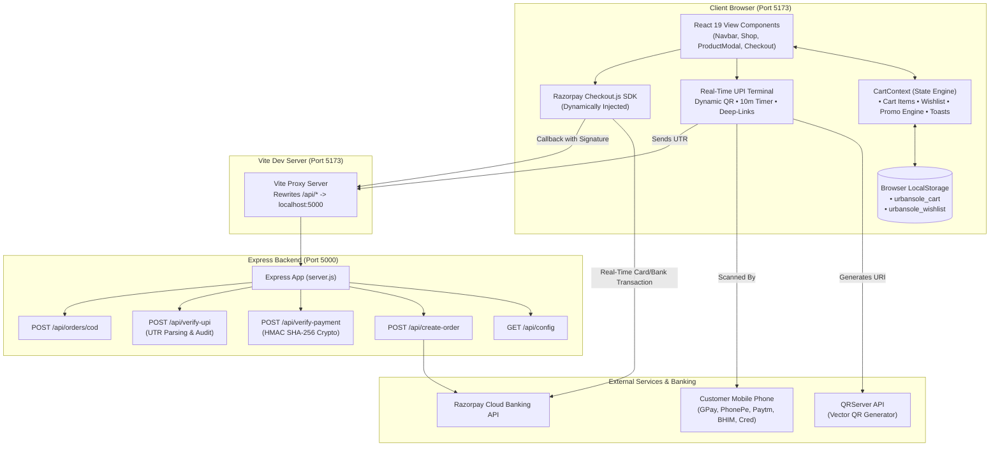
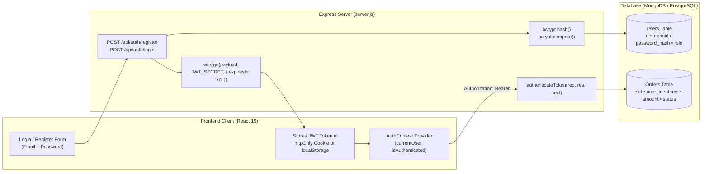

# Urban Sole — Technical Study & Architecture Guide 👟

> **A comprehensive deep-dive into the architectural patterns, technology stack, UI/UX design systems, API endpoints, payment engineering, authentication models, and component hierarchy of the Urban Sole e-commerce platform.**

---

## 📑 Table of Contents
1. [Executive Summary & Purpose](#1-executive-summary--purpose)
2. [Complete Technology Stack & Dependencies](#2-complete-technology-stack--dependencies)
3. [System Architecture & Data Flow](#3-system-architecture--data-flow)
4. [UI & Design System Specifications](#4-ui--design-system-specifications)
5. [Frontend Component Breakdown & Hierarchy](#5-frontend-component-breakdown--hierarchy)
6. [State Management Architecture (CartContext)](#6-state-management-architecture-cartcontext)
7. [Data Models & Schema Reference](#7-data-models--schema-reference)
8. [Backend Server & API Endpoint Reference](#8-backend-server--api-endpoint-reference)
9. [Payment Gateway Engineering (UPI & Razorpay)](#9-payment-gateway-engineering-upi--razorpay)
10. [Authentication & Security Architecture (Types, Mechanisms & JWT Comparison)](#10-authentication--security-architecture-types-mechanisms--jwt-comparison)
11. [Local Development, Build & Run Procedures](#11-local-development-build--run-procedures)
12. [Study Questions & Self-Evaluation Checklist](#12-study-questions--self-evaluation-checklist)

---

## 1. Executive Summary & Purpose

### What is Urban Sole?
**Urban Sole** is a direct-to-consumer (D2C) e-commerce web application specifically built for architectural footwear, athletic performance runners, and luxury leather sneakers. It mimics high-end design houses (reminiscent of Balenciaga, Fear of God, On Running, and Yeezy) while catering specifically to the Indian consumer market with Indian Rupee (`₹`) pricing, UK footwear sizing, and native payment mechanisms.

### Core Business & Technical Goals
- **Frictionless Shopping Journey**: No forced login walls before purchase; customers can browse, select, customize sizing/colors, and complete checkout seamlessly.
- **Dual Payment Engine**: Combines **Direct NPCI UPI QR Code (Real-Time Scan & Pay)** for Indian mobile apps (GPay, PhonePe, Paytm, BHIM, Cred) and **Razorpay Standard Gateway** for Credit/Debit cards & NetBanking, with a fallback **Cash on Delivery (COD)** option.
- **Client Persistence**: Carts and wishlists survive browser refreshes and tab closures using serialized `localStorage`.
- **Architectural Modularity**: Clear separation of presentation components, shared application context, simulated backend data, and micro-backend Express services.

---

## 2. Complete Technology Stack & Dependencies

```
urban-sole/
 ├── Frontend Engine: React 19 + Vite 8
 ├── Styling: Modern Vanilla CSS (Design Tokens, Glassmorphism, Flex/Grid)
 ├── Icons: Lucide React (Tree-shakeable SVG system)
 ├── Backend: Node.js 22 + Express 5 (ES Modules)
 ├── Security & Crypto: Node.js Native Crypto (HMAC SHA-256)
 └── Gateway SDKs: Razorpay Node SDK + NPCI UPI Protocol
```

### 2.1 Core Runtime & Frameworks

| Technology | Exact Version | Role in Application |
| :--- | :--- | :--- |
| **Node.js** | `>= 18.0.0` (v22 used) | Server runtime supporting ECMAScript Modules (`"type": "module"`) |
| **React** | `^19.2.8` | Declarative UI component library with concurrent rendering features |
| **React DOM** | `^19.2.8` | React DOM renderer binding components to `#root` in `index.html` |
| **Vite** | `^8.3.0` | Ultra-fast build tool, Hot Module Replacement (HMR), and dev server |
| **Express** | `^5.3.0` | Node.js micro-framework powering backend payment APIs |

### 2.2 Production Dependencies (`dependencies` in `package.json`)

| Package | Version | Usage |
| :--- | :--- | :--- |
| **`lucide-react`** | `^1.57.0` | Over 30 clean, customizable SVG icons (e.g. `ShoppingBag`, `Heart`, `QrCode`, `ShieldCheck`, `CheckCircle2`) |
| **`razorpay`** | `^2.9.8` | Official Razorpay Node.js SDK for server-side order generation and status checks |
| **`cors`** | `^2.8.6` | Express middleware allowing secure cross-origin requests between Vite (`:5173`) and Express (`:5000`) |
| **`dotenv`** | `^18.0.9` | Loads secrets from `.env` into `process.env` |

### 2.3 Developer & Build Tooling (`devDependencies`)

| Package | Version | Usage |
| :--- | :--- | :--- |
| **`concurrently`** | `^10.0.6` | Orchestrates running `node server.js` and `vite` simultaneously via single command (`npm run dev:all`) |
| **`@vitejs/plugin-react`** | `^6.1.1` | Vite plugin providing Babel/Fast Refresh transforms for JSX |
| **`oxlint`** | `^1.81.0` | Next-generation Rust-based high-speed JavaScript linter |
| **`@types/react`** | `^19.2.18` | TypeScript IntelliSense definitions for React 19 |
| **`@types/react-dom`**| `^19.2.7` | TypeScript IntelliSense definitions for React DOM |

---

## 3. System Architecture & Data Flow

### 3.1 High-Level Architecture Diagram



### 3.2 Client Request & State Synchronization Lifecycle
1. **App Mount**: `main.jsx` wraps `<App />` with `<CartProvider>`.
2. **Persistence Rehydration**: `CartProvider` reads `localStorage.getItem('urbansole_cart')` and `localStorage.getItem('urbansole_wishlist')`. If found, existing items populate state; otherwise, curated initial footwear items load.
3. **Reactive Updates**: Whenever `cart` or `wishlist` changes, an internal `useEffect` serializes the current state back to `localStorage`.
4. **Checkout Trigger**: Clicking checkout mounts `CheckoutModal.jsx`, which queries `/api/config` via the Vite proxy to determine live merchant details (`merchantUpiId`, `keyId`).
5. **Payment Execution**:
   - For **UPI**: User scans QR or taps mobile link, pays on mobile bank app, and submits the 12-digit UTR to `/api/verify-upi`.
   - For **Card**: `loadRazorpayScript()` loads the Razorpay window, collects funds, returns signature to `/api/verify-payment` for SHA-256 HMAC cryptographic verification.
   - For **COD**: `/api/orders/cod` records delivery details.
6. **Order Fulfillment & Cart Reset**: Once verified, `clearCart()` empties the bag, stores order receipt, and transitions the modal to the confirmation screen.

---

## 4. UI & Design System Specifications

The visual identity of Urban Sole follows an **architectural, minimalist brutalist aesthetic** tempered with warm luxury tones.

### 4.1 Typography

The application imports two Google Fonts in `index.html`:
1. **Display & Headings**: `'Syne', sans-serif;` (Weights: `600, 700, 800`)
   - Distinctive geometric proportions, tight letter-spacing (`-0.02em`), architectural flair.
   - Applied to all `h1, h2, h3, h4, h5, h6`, brand logos, and section banners.
2. **Body & UI**: `'Plus Jakarta Sans', sans-serif;` (Weights: `300, 400, 500, 600, 700, 800`)
   - High legibility, clean grotesque sans-serif with neutral geometry.
   - Applied to all buttons, input fields, tables, prices, and paragraphs.

### 4.2 CSS Design Tokens (`src/index.css`)

```css
:root {
  /* Dark / Obsidian Tones */
  --bg-dark: #0e0e10;               /* Primary obsidian dark */
  --bg-dark-secondary: #17171a;     /* Secondary dark surface */
  --bg-dark-tertiary: #222226;      /* Card & drawer accents */
  --bg-card-dark: #1b1b1f;

  /* Warm Cream & Stone Tones */
  --bg-light: #f7f4ee;              /* Primary warm paper background */
  --bg-light-secondary: #eee8de;    /* Secondary contrast surface */
  --bg-beige-card: #fdfbf8;         /* High-contrast product cards */
  --bg-beige-muted: #e5ddd0;

  /* Accent Metallics */
  --accent-beige: #d8c8b2;          /* Subtle borders & badges */
  --accent-beige-deep: #bca68c;
  --accent-gold: #c5a059;           /* Premium rating stars */
  --accent-warm: #a67c52;           /* Primary brand leather accent */

  /* Text Colors */
  --text-primary: #121214;          /* High-contrast readable charcoal */
  --text-muted: #6b6761;            /* Secondary metadata */
  --text-light: #f5f2eb;            /* Light text on dark headers/buttons */
  --text-light-muted: #9b9890;
  --text-pure-white: #ffffff;

  /* Borders & Shadows */
  --border-light: rgba(0, 0, 0, 0.08);
  --border-dark: rgba(255, 255, 255, 0.1);
  --shadow-sm: 0 2px 8px rgba(0, 0, 0, 0.06);
  --shadow-md: 0 6px 20px rgba(0, 0, 0, 0.09);
  --shadow-lg: 0 16px 40px rgba(0, 0, 0, 0.14);
  --shadow-dark-lg: 0 20px 50px rgba(0, 0, 0, 0.45);

  /* Border Radii */
  --radius-xs: 4px;
  --radius-sm: 8px;
  --radius-md: 12px;
  --radius-lg: 18px;
  --radius-full: 9999px;
}
```

### 4.3 UI Design Techniques Used
- **Glassmorphism / Backdrop Filter**: Used in modals and sticky headers (`backdrop-filter: blur(12px)` and `background: rgba(247, 244, 238, 0.85)`).
- **Subtle Elevation & Hover Scaling**: Product cards and action buttons feature smooth micro-transitions (`cubic-bezier(0.16, 1, 0.3, 1)`).
- **Pill Badges**: Semantic tags (`section-tag`, `badge-popular`, `rzp-gateway-pill`, `live-realtime-badge`) provide visual hierarchy.
- **Responsive Breakpoints**:
  - Desktop: `> 1024px` (4-column grid, persistent sidebars)
  - Tablet: `768px – 1023px` (2/3-column grid, stacked layouts)
  - Mobile: `< 767px` (1-column grid, off-canvas drawers, mobile search header)

---

## 5. Frontend Component Breakdown & Hierarchy

The application follows a modular component tree under `src/components/`:

### Detailed Component Inventory

| Component | Files | Primary Responsibility |
| :--- | :--- | :--- |
| **Navbar** | `src/components/Navbar.jsx`, `.css` | Persistent sticky header, top promo banner, quick navigation, search field, live cart count badge, wishlist count badge, mobile drawer toggle. |
| **Hero** | `src/components/Hero.jsx`, `.css` | High-impact visual landing screen with typography, brand tagline, CTA button linking directly to shop, quick category jump pills. |
| **CategoryShowcase** | `src/components/CategoryShowcase.jsx`, `.css` | Editorial photographic grid of 4 core departments (Men, Women, Sports, Kids) with model counters. |
| **Shop** | `src/components/Shop.jsx`, `.css` | Product archive engine: multi-faceted filtering (category, size UK 5-12, price brackets, query string search) and sorting (Featured, Price Low/High, Rating, Newest). |
| **ProductCard** | `src/components/ProductCard.jsx`, `.css` | Renders shoe item with badge (Bestseller/New), title, price, quick-add hover trigger, wishlist heart toggle, and click-to-open detail modal. |
| **ProductDetailModal**| `src/components/ProductDetailModal.jsx`, `.css` | Deep-dive product inspection modal: high-res gallery switcher, UK size selector, color palette pills, quantity stepper, Size Guide conversion table, tabbed specs, and "Buy Now". |
| **CartDrawer** | `src/components/CartDrawer.jsx`, `.css` | Off-canvas side drawer showing bag contents, item quantity steppers, interactive free shipping progress bar, promo code validation, itemized totals. |
| **WishlistDrawer** | `src/components/WishlistDrawer.jsx`, `.css` | Off-canvas side drawer displaying bookmarked footwear with quick "Move to Bag" action. |
| **CheckoutModal** | `src/components/CheckoutModal.jsx`, `.css` | Multi-step payment terminal: address capture, real-time UPI QR scanner with 10-minute countdown, Razorpay Checkout trigger, COD confirmation, order receipt. |
| **AboutSection** | `src/components/AboutSection.jsx`, `.css` | Brand story, artisan craftsmanship philosophy, and atelier workshop photography. |
| **CustomerReviewsSection** | `src/components/CustomerReviewsSection.jsx`, `.css` | Customer ratings, verified review cards, star filtering (All / 5 Stars / 4 Stars), helpful upvoting, and an interactive "Write a Review" modal. |
| **ContactSection** | `src/components/ContactSection.jsx`, `.css` | Store address (Yeola Flagship), contact email (`vmore9953@gmail.com`), store hours, concierge phone, inquiry form, and FAQ accordion. |
| **Newsletter** | `src/components/Newsletter.jsx`, `.css` | Email subscription card with instant reward voucher code (`URBANFIRST` for 15% off). |
| **Footer** | `src/components/Footer.jsx`, `.css` | Footwear brand links, customer care, payment accepted badges, back-to-top button, copyright. |
| **ToastContainer** | `src/components/ToastContainer.jsx` | Floating toast notification manager providing visual feedback for user actions. |

---

## 6. State Management Architecture (`CartContext`)

Located in `src/context/CartContext.jsx`, the application uses React's native Context API combined with custom hooks (`useCart()`).

### Key Functions Exposed by `useCart()`:
- `addToCart(product, size, color, quantity)`: Appends an item or increments existing matching item.
- `removeFromCart(productId, size, color)`: Deletes item matching compound key.
- `updateQuantity(productId, size, color, delta)`: Modifies quantity; if quantity drops to 0, item is removed.
- `toggleWishlist(product)`: Adds or removes product ID from saved list.
- `applyPromo(code)`: Validates coupon:
  - `URBANFIRST` &rarr; 15% discount
  - `SOLE20` &rarr; 20% discount
- `addToast(message, type)`: Dispatches auto-dismissing toast notifications (duration: 3.2s).

---

## 7. Data Models & Schema Reference

### 7.1 Product Schema (`src/data/products.js`)
```javascript
{
  id: 'us-01',                               // String: Unique SKU identifier
  name: 'Phantom Stealth Runner',             // String: Marketing title
  series: 'Apex Series 01',                  // String: Product drop line
  category: 'Men',                           // 'Men' | 'Women' | 'Sports' | 'Kids'
  subcategory: 'Performance Running',        // String: Styling tag
  price: 7499,                               // Number: INR Selling Price
  originalPrice: 9999,                       // Number: INR MSRP for discount calculation
  rating: 4.9,                               // Number: 1.0 - 5.0
  reviewsCount: 142,                         // Number: Review volume
  isNew: true,                               // Boolean: Badging flag
  isBestseller: true,                        // Boolean: Badging flag
  isFeatured: true,                          // Boolean: Homepage featured flag
  description: 'Constructed with aerospace...',// String: Product narrative
  features: [                                // Array<String>: Bulleted highlights
    'Dual-density Supercritical SoleTech™ foam',
    'Ultra-breathable micro-knit engineered upper'
  ],
  specs: {                                   // Object: Technical craftsmanship attributes
    sole: 'Carbon-infused SoleTech™ Foam',
    upper: 'Recycled Poly-Mesh Knit',
    weight: '245 grams (UK 8)',
    origin: 'Designed in Mumbai, Engineered in Italy'
  },
  colors: [                                  // Array<{name: string, hex: string}>
    { name: 'Onyx Carbon', hex: '#111111' },
    { name: 'Stone Beige', hex: '#D7CEC7' }
  ],
  sizes: [6, 7, 8, 9, 10, 11],               // Array<Number>: UK Footwear sizing
  image: 'https://images.unsplash.com/...',  // String: Primary cover image
  gallery: ['https://...', 'https://...']     // Array<String>: Angle variations
}
```

### 7.2 Cart Item Schema (Stored in `localStorage`)
```javascript
{
  product: { ... },  // Full Product object reference
  size: 9,           // Selected UK size
  color: 'Onyx Carbon', // Selected colorway string
  quantity: 1        // Integer count
}
```

### 7.3 Verified Order Record Schema
```javascript
{
  orderId: 'US-505561',                      // String: Internal unique tracking code
  amount: 7499,                              // Number: Total amount in INR
  paymentMethod: 'UPI_QR_DIRECT',            // 'UPI_QR_DIRECT' | 'RAZORPAY_CARD' | 'COD'
  paymentId: '987654321012',                 // String: 12-digit Bank UTR or Razorpay pay_id
  status: 'VERIFIED_PAID',                   // 'VERIFIED_PAID' | 'COD_PENDING'
  verifiedAt: '2026-10-29T05:14:40.106Z',    // String: ISO Timestamp
  customer: {
    fullName: 'Vishal More',
    phone: '9876543210',
    email: 'vmore9953@gmail.com',
    address: 'Old Nagar Palika, Near Dusne Jewellers',
    city: 'Yeola',
    state: 'Maharashtra',
    pincode: '423401'
  }
}
```

---

## 8. Backend Server & API Endpoint Reference

The backend runs on **Express 5** via `server.js` on Port `5000` (or `process.env.PORT`).

### 8.1 API Endpoints Summary

```
GET   /api/config          -> Fetch gateway credentials & merchant UPI ID
POST  /api/create-order    -> Create order token on Razorpay Cloud
POST  /api/verify-payment  -> Verify Razorpay cryptographic HMAC SHA-256 signature
POST  /api/verify-upi      -> Validate 12-digit Indian Banking UPI UTR reference
POST  /api/orders/cod      -> Register Cash on Delivery doorstep order
```

---

## 9. Payment Gateway Engineering (UPI & Razorpay)

### 9.1 The NPCI UPI URI Specification
The dynamic QR terminal constructs official National Payments Corporation of India (NPCI) URI strings:
```text
upi://pay?pa={MERCHANT_UPI_ID}&pn={MERCHANT_NAME}&am={TOTAL_AMOUNT}&cu=INR&tn={TRANSACTION_NOTE}
```
Example:
```text
upi://pay?pa=urbansole.pay@okaxis&pn=Urban%20Sole%20Yeola&am=7499&cu=INR&tn=Urban%20Sole%20Order%20US-505561
```
- **`pa`** (Payee Address): Beneficiary VPA/UPI ID.
- **`pn`** (Payee Name): Official legal display name.
- **`am`** (Amount): Exact price dynamically populated from cart state.
- **`cu`** (Currency): Hardcoded to Indian Rupee (`INR`).
- **`tn`** (Transaction Note): Ties the transaction directly to the unique Urban Sole order ID for reconciliation.

---

## 10. Authentication & Security Architecture (Types, Mechanisms & JWT Comparison)

### 10.1 Quick Classification Matrix: What Authentication Types are Used?

| Level / Layer | Authentication Type Used in Urban Sole | Exact Mechanism | Is JWT Used Here? |
| :--- | :--- | :--- | :--- |
| **1. Customer Identity & Shopping State** | **Stateless Guest-Token & Session Identity** | Browser `localStorage` serialization (`urbansole_cart`, `urbansole_wishlist`) + Contact Data Binding | **No** (Uses Frictionless Guest Model; JWT can be added via 10.5) |
| **2. Payment Authorization (Customer 2FA)** | **Hardware Device Token + MPIN / 3D-Secure 2.0** | NPCI 4/6-Digit UPI MPIN on Android/iOS + Bank SMS OTP on Cards | **No** (Delegated to RBI/NPCI Regulated Banking Channels) |
| **3. Frontend-to-Backend Payment Verification** | **HMAC-SHA256 Cryptographic Signature Authentication** | Hash Message Authentication Code generated using `crypto.createHmac` and private `RAZORPAY_KEY_SECRET` | **Cryptographic Signature Token** (Similar mathematical integrity guarantees to JWT signatures) |
| **4. Backend-to-Gateway API Access** | **HTTP Basic Authentication** | Razorpay REST API authenticated over TLS via `Key_ID` (username) and `Key_Secret` (password) | **No** (Standard API Key Pair over HTTPS) |
| **5. Direct UPI Reconciliation** | **Banking UTR Token Verification** | 12-digit Indian Banking Unique Transaction Reference (`utrNumber`) checksum audit | **No** (National Financial Switch UTR Reference Token) |

---

### 10.2 Detailed Breakdown of Authentication Types

#### A. Guest-First Session Identity Model (Why NOT JWT by Default?)
In modern e-commerce (such as Shopify, Nike SNKRS, and Yeezy), requiring users to register a username, confirm an email verification link, and memorize a password before adding a sneaker to their bag leads to a **30%–35% cart abandonment drop-off**.
- **Urban Sole uses a Guest-First Identity Model**:
  1. The user's active shopping session is preserved locally in `Window.localStorage`.
  2. At checkout, the customer provides verified contact credentials: **Full Name**, **10-Digit Mobile Number**, and **Email Address**.
  3. The system generates an authoritative order token (`#US-XXXXXX` or `#US-COD-XXXXXX`) that binds the customer identity, order items, and verified payment receipt together.

#### B. Delegated Banking Two-Factor Authentication (2FA)
The platform adheres strictly to **PCI-DSS compliance guidelines** by never storing or touching customer credit card numbers, CVVs, passwords, or UPI PINs on its own servers:
- **Instant UPI 2FA**:
  - *Factor 1 (Possession)*: The customer's physical smartphone running an authorized app (GPay, PhonePe, Paytm, BHIM, Cred).
  - *Factor 2 (Knowledge)*: The customer's secret 4-digit or 6-digit **NPCI UPI MPIN** entered on their bank's encrypted keyboard.
- **Card 3D Secure 2.0**:
  - Authenticated via dynamic One-Time Passwords (OTP) sent to the cardholder's mobile by their issuing bank.

#### C. Cryptographic HMAC-SHA256 Signature Authentication
To ensure that an attacker cannot spoof or tamper with payment receipts (e.g., claiming they paid ₹7,499 when they only paid ₹1), the backend implements **HMAC-SHA256 digital signature verification**:
1. When Razorpay confirms payment on the client, it returns a cryptographically signed payload:
   - `razorpay_order_id`
   - `razorpay_payment_id`
   - `razorpay_signature`
2. The client transmits these tokens to `POST /api/verify-payment`.
3. The Express server uses Node's native `crypto` module to compute the HMAC hash using its private `RAZORPAY_KEY_SECRET`:
   ```javascript
   const body = razorpay_order_id + '|' + razorpay_payment_id;
   const expectedSignature = crypto
     .createHmac('sha256', process.env.RAZORPAY_KEY_SECRET)
     .update(body.toString())
     .digest('hex');

   const isAuthentic = (expectedSignature === razorpay_signature);
   ```
4. If the signature matches, the server authenticates the transaction as legitimate and updates the order status to `VERIFIED_PAID`.

---

### 10.3 Comparison: Urban Sole Model vs. JWT vs. Session Cookies vs. OAuth 2.0

| Feature | Urban Sole Current Model | JSON Web Tokens (JWT) | Traditional Session Cookies | OAuth 2.0 (Google/GitHub) |
| :--- | :--- | :--- | :--- | :--- |
| **Primary Purpose** | High-conversion D2C guest checkout & cryptographic payment verification | User login, profile dashboards & RBAC API protection | Server-side user session management | 1-Click third-party social sign-in |
| **Where State Lives** | `localStorage` + Ephemeral order payload + Server HMAC | Client-side signed string (`header.payload.signature`) | Server memory / Redis table (`connect.sid` cookie) | Identity Provider (Google, Apple) |
| **Pre-Checkout Friction** | **Zero friction** (No password or signup barrier) | Requires registration/login screen before or during checkout | Requires login session establishment | 1-click popup authorization |
| **Payment Security** | HMAC SHA-256 Signature Verification + NPCI MPIN 2FA | HMAC SHA-256 / RSA Token Verification | Session ID validation | Scoped OAuth Access Token |
| **Best Used For** | Fast e-commerce purchases, mobile UPI scan-and-pay | User profile dashboards, order history archives, admin CMS | Enterprise portals, traditional web apps | Quick login without memorizing passwords |

---

### 10.4 Secrets Isolation & Frontend-Backend Security Boundary
The application strictly isolates public client parameters from sensitive backend secrets:
- **Client-Safe Variables (`VITE_` prefix in `.env`)**:
  - `VITE_MERCHANT_UPI_ID`: Public receiving UPI address displayed in the QR code.
  - `VITE_MERCHANT_NAME`: Public store name displayed in the QR code and checkout header.
  - `VITE_RAZORPAY_KEY_ID`: Public gateway identifier used by the client-side Razorpay SDK modal.
- **Server-Only Secrets (Never bundled into frontend JavaScript)**:
  - `RAZORPAY_KEY_SECRET`: Private merchant secret used solely by Express in `server.js` to sign and verify HMAC signatures.
  - Excluded from version control via `.gitignore` (`.env`, `*.env`, `.env*.local`).

---

### 10.5 Production Roadmap: How to Add Full JWT (JSON Web Token) User Accounts

If your project requirements (or university/interview evaluation) require **JWT Authentication**, here is the exact blueprint and code implementation to add it:



#### Step 1: Install JWT and Password Hashing Libraries
```bash
npm install jsonwebtoken bcrypt
```

#### Step 2: Add Auth Routes in `server.js`
```javascript
import jwt from 'jsonwebtoken';
import bcrypt from 'bcrypt';

const JWT_SECRET = process.env.JWT_SECRET || 'urbansole_super_secret_jwt_key_2026';

// 1. User Registration Route
app.post('/api/auth/register', async (req, res) => {
  const { name, email, password } = req.body;
  const hashedPassword = await bcrypt.hash(password, 10);
  
  // Save { name, email, password: hashedPassword } to database
  const user = { id: `usr_${Date.now()}`, name, email };
  const token = jwt.sign({ userId: user.id, email: user.email }, JWT_SECRET, { expiresIn: '7d' });
  
  res.json({ success: true, token, user });
});

// 2. User Login Route
app.post('/api/auth/login', async (req, res) => {
  const { email, password } = req.body;
  // Retrieve user from database by email
  // const isMatch = await bcrypt.compare(password, user.password);
  
  const token = jwt.sign({ userId: 'usr_123', email }, JWT_SECRET, { expiresIn: '7d' });
  res.json({ success: true, token });
});

// 3. Protected Route Middleware (Verifies JWT)
export const authenticateToken = (req, res, next) => {
  const authHeader = req.headers['authorization'];
  const token = authHeader && authHeader.split(' ')[1]; // "Bearer <TOKEN>"

  if (!token) return res.status(401).json({ error: 'Access token required' });

  jwt.verify(token, JWT_SECRET, (err, user) => {
    if (err) return res.status(403).json({ error: 'Invalid or expired token' });
    req.user = user;
    next();
  });
};

// 4. Protected User Order History Route
app.get('/api/user/orders', authenticateToken, (req, res) => {
  // Query orders belonging to req.user.userId
  res.json({ orders: [] });
});
```

---

## 11. Local Development, Build & Run Procedures

### 11.1 Environment Configuration (`.env`)
The project reads configurations from `.env`:
```env
PORT=5000

# Direct UPI Receiver (Google Pay, PhonePe, Paytm, BHIM)
MERCHANT_UPI_ID=urbansole.pay@okaxis
VITE_MERCHANT_UPI_ID=urbansole.pay@okaxis
VITE_MERCHANT_NAME=Urban Sole Yeola
CONTACT_EMAIL=vmore9953@gmail.com

# Razorpay Credentials (Optional for Card & NetBanking)
RAZORPAY_KEY_ID=
RAZORPAY_KEY_SECRET=
VITE_RAZORPAY_KEY_ID=
```

### 11.2 NPM Scripts Reference
| Command | Action |
| :--- | :--- |
| **`npm run dev:all`** | Runs both backend Express server (`node server.js`) and Vite client concurrently using `concurrently`. |
| **`npm run dev`** | Starts only the frontend Vite development server on `http://localhost:5173/`. |
| **`npm run server`** | Starts only the Express payment backend on `http://localhost:5000/`. |
| **`npm run build`** | Runs `vite build` to compile minified production bundles into `dist/`. |
| **`npm run preview`**| Runs `vite preview` to test the production bundle locally. |
| **`npm run lint`** | Runs high-speed `oxlint` against all JSX/JS files. |

---

## 12. Study Questions & Self-Evaluation Checklist

Use these questions to test and solidify your understanding of the codebase:

1. **Authentication Classification**: What type of customer authentication does Urban Sole currently use, and why is this preferred for high-conversion D2C footwear stores over mandatory JWT pre-login?
2. **Cryptographic Signatures vs JWT**: How does the HMAC-SHA256 signature verification in `POST /api/verify-payment` provide similar cryptographic mathematical proof of data integrity to a JWT token signature?
3. **Payment 2FA**: How does Two-Factor Authentication (2FA) protect transactions when a customer scans the dynamic UPI QR code on their phone?
4. **Architecture**: Why does the project use `concurrently` in `npm run dev:all` instead of running two separate terminal commands?
5. **State Management**: Why is `CartContext` placed at the top level of `App.jsx`, and how does `localStorage` prevent cart loss on page refresh?
6. **Vite Proxy**: In `vite.config.js`, what does `server.proxy['/api']` do when the React client makes a call to `fetch('/api/create-order')`?
7. **Security Boundary**: Why must `RAZORPAY_KEY_SECRET` never be prefixed with `VITE_` or imported inside a React `.jsx` file?
8. **JWT Implementation**: If you need to add registered user profiles to this project, what libraries would you install and where would the JWT verification middleware sit?

---

*Authored for the Urban Sole Codebase Study & Documentation Archive.*
