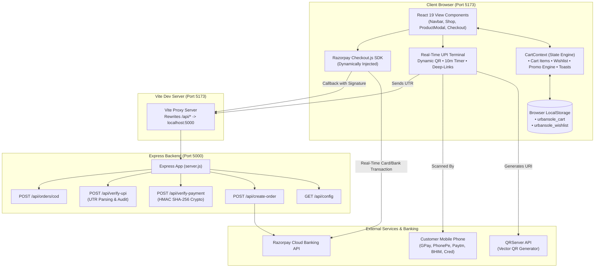

# Urban Sole — Technical Study & Architecture Guide 👟

> **A comprehensive deep-dive into the architectural patterns, technology stack, UI/UX design systems, API endpoints, payment engineering, authentication models, database architecture, and component hierarchy of the Urban Sole e-commerce platform.**

---

## 📑 Table of Contents
1. [Executive Summary & Purpose](#1-executive-summary--purpose)
2. [Complete Technology Stack & Dependencies](#2-complete-technology-stack--dependencies)
3. [System Architecture & Data Flow](#3-system-architecture--data-flow)
4. [UI & Design System Specifications](#4-ui--design-system-specifications)
5. [Frontend Component Breakdown & Hierarchy](#5-frontend-component-breakdown--hierarchy)
6. [State Management Architecture (CartContext)](#6-state-management-architecture-cartcontext)
7. [Database Architecture, Collections & Schemas](#7-database-architecture-collections--schemas)
8. [Backend Server & API Endpoint Reference](#8-backend-server--api-endpoint-reference)
9. [Payment Gateway Engineering (UPI & Razorpay)](#9-payment-gateway-engineering-upi--razorpay)
10. [Authentication & Security Architecture (Types, Mechanisms & JWT Comparison)](#10-authentication--security-architecture-types-mechanisms--jwt-comparison)
11. [Local Development, Build & Run Procedures](#11-local-development-build--run-procedures)
12. [Study Questions & Self-Evaluation Checklist](#12-study-questions--self-evaluation-checklist)

---

## 1. Executive Summary & Purpose

### What is Urban Sole?
**Urban Sole** is a direct-to-consumer (D2C) e-commerce web application specifically built for architectural footwear, athletic performance runners, and luxury leather sneakers. It mimics high-end design houses (reminiscent of Balenciaga, Fear of God, On Running, and Yeezy) while catering specifically to the Indian consumer market with Indian Rupee (`₹`) pricing, UK footwear sizing, and native payment mechanisms.

### Core Business & Technical Goals
- **Frictionless Shopping Journey**: No forced login walls before purchase; customers can browse, select, customize sizing/colors, and complete checkout seamlessly.
- **Dual Payment Engine**: Combines **Direct NPCI UPI QR Code (Real-Time Scan & Pay)** for Indian mobile apps (GPay, PhonePe, Paytm, BHIM, Cred) and **Razorpay Standard Gateway** for Credit/Debit cards & NetBanking, with a fallback **Cash on Delivery (COD)** option.
- **Client Persistence**: Carts and wishlists survive browser refreshes and tab closures using serialized `localStorage`.
- **Architectural Modularity**: Clear separation of presentation components, shared application context, simulated backend data, and micro-backend Express services.

---

## 2. Complete Technology Stack & Dependencies

```
urban-sole/
 ├── Frontend Engine: React 19 + Vite 8
 ├── Styling: Modern Vanilla CSS (Design Tokens, Glassmorphism, Flex/Grid)
 ├── Icons: Lucide React (Tree-shakeable SVG system)
 ├── Backend: Node.js 22 + Express 5 (ES Modules)
 ├── Security & Crypto: Node.js Native Crypto (HMAC SHA-256)
 ├── Storage / DB: Web Storage API (localStorage) + Structured In-Memory JSON
 └── Gateway SDKs: Razorpay Node SDK + NPCI UPI Protocol
```

### 2.1 Core Runtime & Frameworks

| Technology | Exact Version | Role in Application |
| :--- | :--- | :--- |
| **Node.js** | `>= 18.0.0` (v22 used) | Server runtime supporting ECMAScript Modules (`"type": "module"`) |
| **React** | `^19.2.8` | Declarative UI component library with concurrent rendering features |
| **React DOM** | `^19.2.8` | React DOM renderer binding components to `#root` in `index.html` |
| **Vite** | `^8.3.0` | Ultra-fast build tool, Hot Module Replacement (HMR), and dev server |
| **Express** | `^5.3.0` | Node.js micro-framework powering backend payment APIs |

### 2.2 Production Dependencies (`dependencies` in `package.json`)

| Package | Version | Usage |
| :--- | :--- | :--- |
| **`lucide-react`** | `^1.57.0` | Over 30 clean, customizable SVG icons (e.g. `ShoppingBag`, `Heart`, `QrCode`, `ShieldCheck`, `CheckCircle2`) |
| **`razorpay`** | `^2.9.8` | Official Razorpay Node.js SDK for server-side order generation and status checks |
| **`cors`** | `^2.8.6` | Express middleware allowing secure cross-origin requests between Vite (`:5173`) and Express (`:5000`) |
| **`dotenv`** | `^18.0.9` | Loads secrets from `.env` into `process.env` |

### 2.3 Developer & Build Tooling (`devDependencies`)

| Package | Version | Usage |
| :--- | :--- | :--- |
| **`concurrently`** | `^10.0.6` | Orchestrates running `node server.js` and `vite` simultaneously via single command (`npm run dev:all`) |
| **`@vitejs/plugin-react`** | `^6.1.1` | Vite plugin providing Babel/Fast Refresh transforms for JSX |
| **`oxlint`** | `^1.81.0` | Next-generation Rust-based high-speed JavaScript linter |
| **`@types/react`** | `^19.2.18` | TypeScript IntelliSense definitions for React 19 |
| **`@types/react-dom`**| `^19.2.7` | TypeScript IntelliSense definitions for React DOM |

---

## 3. System Architecture & Data Flow

### 3.1 High-Level Architecture Diagram



---

## 4. UI & Design System Specifications

The visual identity of Urban Sole follows an **architectural, minimalist brutalist aesthetic** tempered with warm luxury tones.

### 4.1 Typography

The application imports two Google Fonts in `index.html`:
1. **Display & Headings**: `'Syne', sans-serif;` (Weights: `600, 700, 800`)
   - Distinctive geometric proportions, tight letter-spacing (`-0.02em`), architectural flair.
   - Applied to all `h1, h2, h3, h4, h5, h6`, brand logos, and section banners.
2. **Body & UI**: `'Plus Jakarta Sans', sans-serif;` (Weights: `300, 400, 500, 600, 700, 800`)
   - High legibility, clean grotesque sans-serif with neutral geometry.
   - Applied to all buttons, input fields, tables, prices, and paragraphs.

### 4.2 CSS Design Tokens (`src/index.css`)

```css
:root {
  /* Dark / Obsidian Tones */
  --bg-dark: #0e0e10;               /* Primary obsidian dark */
  --bg-dark-secondary: #17171a;     /* Secondary dark surface */
  --bg-dark-tertiary: #222226;      /* Card & drawer accents */
  --bg-card-dark: #1b1b1f;

  /* Warm Cream & Stone Tones */
  --bg-light: #f7f4ee;              /* Primary warm paper background */
  --bg-light-secondary: #eee8de;    /* Secondary contrast surface */
  --bg-beige-card: #fdfbf8;         /* High-contrast product cards */
  --bg-beige-muted: #e5ddd0;

  /* Accent Metallics */
  --accent-beige: #d8c8b2;          /* Subtle borders & badges */
  --accent-beige-deep: #bca68c;
  --accent-gold: #c5a059;           /* Premium rating stars */
  --accent-warm: #a67c52;           /* Primary brand leather accent */

  /* Text Colors */
  --text-primary: #121214;          /* High-contrast readable charcoal */
  --text-muted: #6b6761;            /* Secondary metadata */
  --text-light: #f5f2eb;            /* Light text on dark headers/buttons */
  --text-light-muted: #9b9890;
  --text-pure-white: #ffffff;

  /* Borders & Shadows */
  --border-light: rgba(0, 0, 0, 0.08);
  --border-dark: rgba(255, 255, 255, 0.1);
  --shadow-sm: 0 2px 8px rgba(0, 0, 0, 0.06);
  --shadow-md: 0 6px 20px rgba(0, 0, 0, 0.09);
  --shadow-lg: 0 16px 40px rgba(0, 0, 0, 0.14);
  --shadow-dark-lg: 0 20px 50px rgba(0, 0, 0, 0.45);

  /* Border Radii */
  --radius-xs: 4px;
  --radius-sm: 8px;
  --radius-md: 12px;
  --radius-lg: 18px;
  --radius-full: 9999px;
}
```

---

## 5. Frontend Component Breakdown & Hierarchy

The application follows a modular component tree under `src/components/`:

| Component | Files | Primary Responsibility |
| :--- | :--- | :--- |
| **Navbar** | `src/components/Navbar.jsx`, `.css` | Persistent sticky header, top promo banner, quick navigation, search field, live cart count badge, wishlist count badge, mobile drawer toggle. |
| **Hero** | `src/components/Hero.jsx`, `.css` | High-impact visual landing screen with typography, brand tagline, CTA button linking directly to shop, quick category jump pills. |
| **CategoryShowcase** | `src/components/CategoryShowcase.jsx`, `.css` | Editorial photographic grid of 4 core departments (Men, Women, Sports, Kids) with model counters. |
| **Shop** | `src/components/Shop.jsx`, `.css` | Product archive engine: multi-faceted filtering (category, size UK 5-12, price brackets, query string search) and sorting (Featured, Price Low/High, Rating, Newest). |
| **ProductCard** | `src/components/ProductCard.jsx`, `.css` | Renders shoe item with badge (Bestseller/New), title, price, quick-add hover trigger, wishlist heart toggle, and click-to-open detail modal. |
| **ProductDetailModal**| `src/components/ProductDetailModal.jsx`, `.css` | Deep-dive product inspection modal: high-res gallery switcher, UK size selector, color palette pills, quantity stepper, Size Guide conversion table, tabbed specs, and "Buy Now". |
| **CartDrawer** | `src/components/CartDrawer.jsx`, `.css` | Off-canvas side drawer showing bag contents, item quantity steppers, interactive free shipping progress bar, promo code validation, itemized totals. |
| **WishlistDrawer** | `src/components/WishlistDrawer.jsx`, `.css` | Off-canvas side drawer displaying bookmarked footwear with quick "Move to Bag" action. |
| **CheckoutModal** | `src/components/CheckoutModal.jsx`, `.css` | Multi-step payment terminal: address capture, real-time UPI QR scanner with 10-minute countdown, Razorpay Checkout trigger, COD confirmation, order receipt. |
| **AboutSection** | `src/components/AboutSection.jsx`, `.css` | Brand story, artisan craftsmanship philosophy, and atelier workshop photography. |
| **CustomerReviewsSection** | `src/components/CustomerReviewsSection.jsx`, `.css` | Customer ratings, verified review cards, star filtering (All / 5 Stars / 4 Stars), helpful upvoting, and an interactive "Write a Review" modal. |
| **ContactSection** | `src/components/ContactSection.jsx`, `.css` | Store address (Yeola Flagship), contact email (`vmore9953@gmail.com`), store hours, concierge phone, inquiry form, and FAQ accordion. |
| **Newsletter** | `src/components/Newsletter.jsx`, `.css` | Email subscription card with instant reward voucher code (`URBANFIRST` for 15% off). |
| **Footer** | `src/components/Footer.jsx`, `.css` | Footwear brand links, customer care, payment accepted badges, back-to-top button, copyright. |
| **ToastContainer** | `src/components/ToastContainer.jsx` | Floating toast notification manager providing visual feedback for user actions. |

---

## 6. State Management Architecture (`CartContext`)

Located in `src/context/CartContext.jsx`, the application uses React's native Context API combined with custom hooks (`useCart()`).

### Key Functions Exposed by `useCart()`:
- `addToCart(product, size, color, quantity)`: Appends an item or increments existing matching item.
- `removeFromCart(productId, size, color)`: Deletes item matching compound key.
- `updateQuantity(productId, size, color, delta)`: Modifies quantity; if quantity drops to 0, item is removed.
- `toggleWishlist(product)`: Adds or removes product ID from saved list.
- `applyPromo(code)`: Validates coupon (`URBANFIRST` &rarr; 15% off, `SOLE20` &rarr; 20% off).
- `addToast(message, type)`: Dispatches auto-dismissing toast notifications (duration: 3.2s).

---

## 7. Database Architecture, Collections & Schemas

### 7.1 Current Database Implementation: Hybrid Client-Storage & In-Memory Model
In its current release, Urban Sole uses a **Hybrid Client-Storage & Structured In-Memory Database Architecture**:
1. **Client Persistence Layer (`localStorage`)**:
   - `Window.localStorage.getItem('urbansole_cart')`: Acts as an ephemeral client-side document database saving cart contents, quantities, sizes, and colors.
   - `Window.localStorage.getItem('urbansole_wishlist')`: Stores an array of favorited product IDs.
   - Survives browser refreshes, tab closures, and computer reboots.
2. **Product & Review Catalog Layer (`src/data/*.js`)**:
   - Structured JSON-in-JS document database holding all footwear collections (`PRODUCTS`), departments (`CATEGORIES`), verified testimonials (`REVIEWS`), and store information (`FAQS`).
   - Advantage: Delivers sub-millisecond instant search, filtering, and sorting without database round-trip network latency.
3. **Transaction Audit Layer (`server.js`)**:
   - In-memory order token generation, cryptographic HMAC signature auditing, and terminal logging.

---

### 7.2 Database Collections / Tables Reference (Schema Models)

```mermaid
erDiagram
    PRODUCT ||--o{ CART_ITEM : "contains"
    PRODUCT ||--o{ REVIEW : "has"
    CUSTOMER ||--o{ ORDER : "places"
    ORDER ||--|{ ORDER_ITEM : "includes"
    ORDER ||--|| PAYMENT_TRANSACTION : "verified_by"

    PRODUCT {
        string id PK "e.g. us-01"
        string name "Phantom Stealth Runner"
        string series "Apex Series 01"
        string category "Men | Women | Sports | Kids"
        string subcategory "Performance Running"
        number price "Selling Price (INR)"
        number originalPrice "MSRP (INR)"
        number rating "1.0 - 5.0"
        number reviewsCount
        boolean isNew
        boolean isBestseller
        string description
        string array features
        json specs
        json colors
        number array sizes
        string image
        string array gallery
    }

    CUSTOMER {
        string fullName "e.g. Vishal More"
        string phone "10-digit mobile"
        string email "vmore9953@gmail.com"
        string address "Old Nagar Palika, Near Dusne Jewellers"
        string city "Yeola"
        string state "Maharashtra"
        string pincode "423401"
    }

    ORDER {
        string orderId PK "e.g. US-505561"
        string customerEmail FK
        number totalAmount "INR"
        number subtotal "INR"
        number discountAmount "INR"
        number shippingFee "INR"
        string status "VERIFIED_PAID | COD_PENDING"
        string paymentMethod "UPI_QR_DIRECT | RAZORPAY_CARD | COD"
        datetime createdAt
    }

    PAYMENT_TRANSACTION {
        string transactionId PK "Bank UTR or Razorpay pay_id"
        string orderId FK
        string gateway "NPCI_UPI | RAZORPAY"
        string signature "HMAC SHA-256 hash"
        string status "SUCCESS | FAILED"
        datetime verifiedAt
    }
```

#### Collection 1: `products`
| Field | Type | Required | Description |
| :--- | :--- | :--- | :--- |
| `id` | `String` | Yes | Unique SKU identifier (e.g. `'us-01'`) |
| `name` | `String` | Yes | Footwear name |
| `series` | `String` | No | Drop edition (e.g. `'Apex Series 01'`) |
| `category` | `String` | Yes | Target gender/type: `'Men'`, `'Women'`, `'Sports'`, `'Kids'` |
| `subcategory` | `String` | Yes | Niche category (e.g. `'Lifestyle Trainers'`) |
| `price` | `Number` | Yes | Current price in Indian Rupees |
| `originalPrice` | `Number` | No | Strikethrough comparison MSRP |
| `rating` | `Number` | Yes | Float rating (e.g. `4.9`) |
| `reviewsCount`| `Number` | Yes | Number of verified customer reviews |
| `specs` | `Object` | Yes | `{ sole: String, upper: String, weight: String, origin: String }` |
| `colors` | `Array<Object>`| Yes | `[{ name: 'Onyx Carbon', hex: '#111111' }]` |
| `sizes` | `Array<Number>`| Yes | Available UK sizing array `[6, 7, 8, 9, 10, 11]` |
| `image` | `String` | Yes | Primary high-res thumbnail URL |
| `gallery` | `Array<String>`| No | Multi-angle photographic showcase URLs |

#### Collection 2: `orders`
| Field | Type | Required | Description |
| :--- | :--- | :--- | :--- |
| `orderId` | `String` | Yes | Primary Key tracking reference (e.g. `'US-701960'`) |
| `customer` | `Object` | Yes | Embedded customer object: `{ fullName, phone, email, address, city, state, pincode }` |
| `items` | `Array<Object>`| Yes | Array of ordered items: `[{ productId, name, size, color, quantity, price }]` |
| `subtotal` | `Number` | Yes | Pre-discount footwear subtotal |
| `discountAmount`| `Number`| Yes | Coupon discount deducted in INR |
| `shippingFee` | `Number` | Yes | Delivery fee (`0` if subtotal >= 2999, else `250`) |
| `totalAmount` | `Number` | Yes | Final payable amount |
| `paymentMethod`| `String` | Yes | `'UPI_QR_DIRECT'`, `'RAZORPAY_CARD'`, or `'COD'` |
| `paymentId` | `String` | Yes | Bank 12-digit UTR reference or Razorpay payment ID |
| `status` | `String` | Yes | `'VERIFIED_PAID'` or `'COD_PENDING'` |
| `createdAt` | `Date` | Yes | ISO timestamp of order placement |

#### Collection 3: `reviews`
| Field | Type | Required | Description |
| :--- | :--- | :--- | :--- |
| `id` | `String` | Yes | Review ID (e.g. `'rev-01'`) |
| `name` | `String` | Yes | Reviewer customer name |
| `city` | `String` | Yes | Customer city location (e.g. `'Yeola'`, `'Nashik'`) |
| `productName` | `String` | Yes | Footwear model reviewed |
| `rating` | `Number` | Yes | Star score: `1` to `5` |
| `title` | `String` | Yes | Headline summary of review |
| `content` | `String` | Yes | Testimonial narrative |
| `likes` | `Number` | Yes | Helpful upvote counter |

---

### 7.3 Production Database Migration: How to Plug in MongoDB (Mongoose)

If you wish to replace the in-memory/localStorage layer with **MongoDB & Mongoose**, here is the exact copy-paste blueprint:

#### Step 1: Install Mongoose in Backend
```bash
npm install mongoose
```

#### Step 2: Define Mongoose Schemas (`server/models/Order.js`)
```javascript
import mongoose from 'mongoose';

const OrderSchema = new mongoose.Schema({
  orderId: { type: String, required: true, unique: true },
  customer: {
    fullName: { type: String, required: true },
    phone: { type: String, required: true },
    email: { type: String, required: true },
    address: { type: String, required: true },
    city: { type: String, required: true },
    state: { type: String, required: true },
    pincode: { type: String, required: true }
  },
  items: [{
    productId: String,
    name: String,
    size: Number,
    color: String,
    quantity: Number,
    price: Number
  }],
  totalAmount: { type: Number, required: true },
  paymentMethod: { type: String, enum: ['UPI_QR_DIRECT', 'RAZORPAY_CARD', 'COD'], required: true },
  paymentId: { type: String, required: true },
  status: { type: String, default: 'VERIFIED_PAID' },
  createdAt: { type: Date, default: Date.now }
});

export const Order = mongoose.model('Order', OrderSchema);
```

#### Step 3: Connect to MongoDB in `server.js`
```javascript
import mongoose from 'mongoose';

mongoose.connect(process.env.MONGODB_URI || 'mongodb://localhost:27017/urbansole')
  .then(() => console.log('✅ MongoDB connected successfully'))
  .catch((err) => console.error('❌ MongoDB connection error:', err));
```

#### Step 4: Persist in Payment Verification Endpoint
```javascript
// Inside /api/verify-upi or /api/verify-payment in server.js:
const newOrder = new Order({
  orderId,
  customer: customerData,
  items: cartItems,
  totalAmount,
  paymentMethod: 'UPI_QR_DIRECT',
  paymentId: utrNumber,
  status: 'VERIFIED_PAID'
});
await newOrder.save();
```

---

## 8. Backend Server & API Endpoint Reference

The backend runs on **Express 5** via `server.js` on Port `5000` (or `process.env.PORT`).

```
GET   /api/config          -> Fetch gateway credentials & merchant UPI ID
POST  /api/create-order    -> Create order token on Razorpay Cloud
POST  /api/verify-payment  -> Verify Razorpay cryptographic HMAC SHA-256 signature
POST  /api/verify-upi      -> Validate 12-digit Indian Banking UPI UTR reference
POST  /api/orders/cod      -> Register Cash on Delivery doorstep order
```

---

## 9. Payment Gateway Engineering (UPI & Razorpay)

### 9.1 The NPCI UPI URI Specification
The dynamic QR terminal constructs official National Payments Corporation of India (NPCI) URI strings:
```text
upi://pay?pa={MERCHANT_UPI_ID}&pn={MERCHANT_NAME}&am={TOTAL_AMOUNT}&cu=INR&tn={TRANSACTION_NOTE}
```
Example:
```text
upi://pay?pa=urbansole.pay@okaxis&pn=Urban%20Sole%20Yeola&am=7499&cu=INR&tn=Urban%20Sole%20Order%20US-505561
```
- **`pa`** (Payee Address): Beneficiary VPA/UPI ID.
- **`pn`** (Payee Name): Official legal display name.
- **`am`** (Amount): Exact price dynamically populated from cart state.
- **`cu`** (Currency): Hardcoded to Indian Rupee (`INR`).
- **`tn`** (Transaction Note): Ties the transaction directly to the unique Urban Sole order ID for reconciliation.

---

## 10. Authentication & Security Architecture (Types, Mechanisms & JWT Comparison)

### 10.1 Quick Classification Matrix: What Authentication Types are Used?

| Level / Layer | Authentication Type Used in Urban Sole | Exact Mechanism | Is JWT Used Here? |
| :--- | :--- | :--- | :--- |
| **1. Customer Identity & Shopping State** | **Stateless Guest-Token & Session Identity** | Browser `localStorage` serialization (`urbansole_cart`, `urbansole_wishlist`) + Contact Data Binding | **No** (Uses Frictionless Guest Model; JWT can be added via 10.5) |
| **2. Payment Authorization (Customer 2FA)** | **Hardware Device Token + MPIN / 3D-Secure 2.0** | NPCI 4/6-Digit UPI MPIN on Android/iOS + Bank SMS OTP on Cards | **No** (Delegated to RBI/NPCI Regulated Banking Channels) |
| **3. Frontend-to-Backend Payment Verification** | **HMAC-SHA256 Cryptographic Signature Authentication** | Hash Message Authentication Code generated using `crypto.createHmac` and private `RAZORPAY_KEY_SECRET` | **Cryptographic Signature Token** (Similar mathematical integrity guarantees to JWT signatures) |
| **4. Backend-to-Gateway API Access** | **HTTP Basic Authentication** | Razorpay REST API authenticated over TLS via `Key_ID` (username) and `Key_Secret` (password) | **No** (Standard API Key Pair over HTTPS) |
| **5. Direct UPI Reconciliation** | **Banking UTR Token Verification** | 12-digit Indian Banking Unique Transaction Reference (`utrNumber`) checksum audit | **No** (National Financial Switch UTR Reference Token) |

---

## 11. Local Development, Build & Run Procedures

### 11.1 Environment Configuration (`.env`)
The project reads configurations from `.env`:
```env
PORT=5000

# Direct UPI Receiver (Google Pay, PhonePe, Paytm, BHIM)
MERCHANT_UPI_ID=urbansole.pay@okaxis
VITE_MERCHANT_UPI_ID=urbansole.pay@okaxis
VITE_MERCHANT_NAME=Urban Sole Yeola
CONTACT_EMAIL=vmore9953@gmail.com

# Razorpay Credentials (Optional for Card & NetBanking)
RAZORPAY_KEY_ID=
RAZORPAY_KEY_SECRET=
VITE_RAZORPAY_KEY_ID=
```

### 11.2 NPM Scripts Reference
| Command | Action |
| :--- | :--- |
| **`npm run dev:all`** | Runs both backend Express server (`node server.js`) and Vite client concurrently using `concurrently`. |
| **`npm run dev`** | Starts only the frontend Vite development server on `http://localhost:5173/`. |
| **`npm run server`** | Starts only the Express payment backend on `http://localhost:5000/`. |
| **`npm run build`** | Runs `vite build` to compile minified production bundles into `dist/`. |
| **`npm run preview`**| Runs `vite preview` to test the production bundle locally. |
| **`npm run lint`** | Runs high-speed `oxlint` against all JSX/JS files. |

---

## 12. Study Questions & Self-Evaluation Checklist

Use these questions to test and solidify your understanding of the codebase:

1. **Database Architecture**: How does Urban Sole currently persist the user's cart without requiring a local MongoDB or PostgreSQL installation?
2. **Collections & Schemas**: What are the key fields stored in an `Order` document when an instant UPI QR payment is confirmed?
3. **Database Migration**: If you connect MongoDB via `mongoose.connect()`, which Express endpoint would call `await newOrder.save()`?
4. **Authentication Classification**: What type of customer authentication does Urban Sole currently use, and why is this preferred for high-conversion D2C footwear stores over mandatory JWT pre-login?
5. **Cryptographic Signatures vs JWT**: How does the HMAC-SHA256 signature verification in `POST /api/verify-payment` provide similar cryptographic mathematical proof of data integrity to a JWT token signature?
6. **Payment 2FA**: How does Two-Factor Authentication (2FA) protect transactions when a customer scans the dynamic UPI QR code on their phone?
7. **Pricing Engine**: How does `subtotal >= 2999` dynamically recalculate the free shipping progress meter, shipping fee waiver, and final total?

---

*Authored for the Urban Sole Codebase Study & Documentation Archive.*
